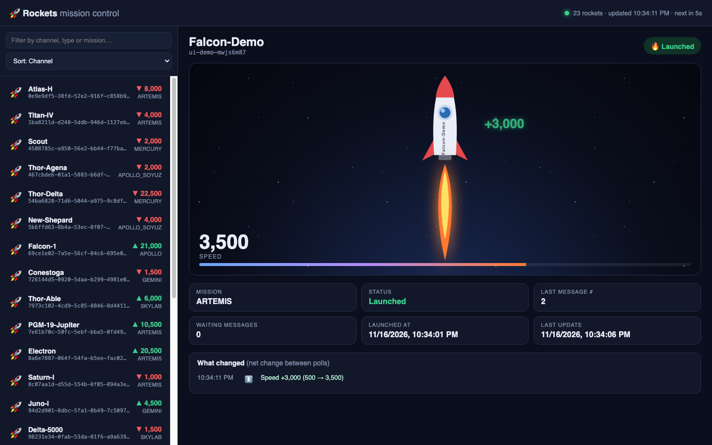

# rockets-ui



A small React page for watching the Rockets service live. A demo aid: it only reads the public `GET /rockets`.

- Left: every rocket (type, channel ID, speed with a ▲/▼ trend, mission), with a filter and sort options.
- Right: the selected rocket in flight. Stars move faster as speed rises; the rocket boosts or brakes when its speed
  changes, a toast shows a new mission, and an explosion plays when it explodes. Below are its details and a list of what changed.
- Updates by **polling `GET /rockets` every 5 seconds** (no WebSocket or SignalR). Changes are worked out in the browser
  by comparing two polls, so they are *net* changes over those 5 seconds.

## Run

`docker compose up --build` in `rockets-service/` starts it at **http://localhost:3088** (nginx serves the built app and
forwards `/api/*` to `rockets-api`). For UI development instead:

```bash
cd ui
npm install
npm run dev          # http://localhost:5173, forwards /api/* to http://localhost:8088

# 3. send messages slowly enough to watch (from the challenge folder)
./rockets launch "http://localhost:8088/messages" --message-delay=100ms
```

The Vite dev server forwards `/api/*` to `http://localhost:8088`, so the browser never calls the service directly and the
service needs no CORS changes. Point it somewhere else with `ROCKETS_API=http://localhost:18087 npm run dev`.
